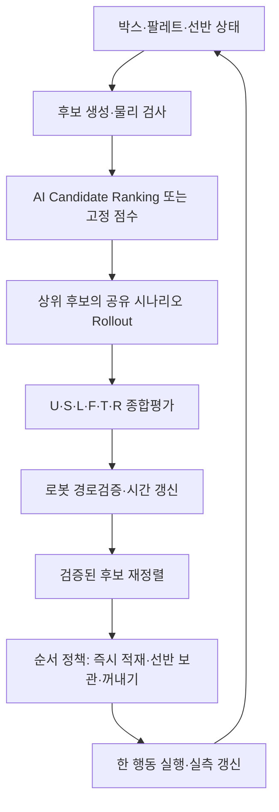

# 동한 담당: 점수 기반 패턴 평가 개발 v1

작성 기준: 2026-10-05. 목적은 **각 적재 후보의 장단점을 동일한 수식으로 계산하고, 후보 순위와 선택 근거를 돌려주는 평가기**를 먼저 만드는 것이다.

## 1. 자료에서 확인한 내용과 이번 구현 판단

| 근거 | 확인한 내용 | 적용 |
|---|---|---|
| `PAC2026_AHEAD_아이디어요약서_최종본.txt` §2·3 | AI Future Value / Candidate Ranking으로 1차 평가 → 상위 후보 명시적 가상적재. 평가식 `wU·U+wS·S+wL·L+wF·F−wT·T−wR·R`. 가중치는 시뮬레이션 비교로 조정 | 여섯 항목 및 평가 순서 유지 |
| `PAC2026_수정_아이디어요약서.txt` §③ | 각 항목 0~1, 미래성과와 위험에서 감점 중복 방지. 경로 검증 후 예상시간을 갱신 | 항목별 점수·기여도 출력, 경로시간을 넣고 재정렬 |
| 사용자 메시지에 인용된 팀장님 발언 | Candidate Ranking 유지. PPO는 이후 현재 박스 즉시 적재 / Buffer에 보관 / Buffer에서 어떤 박스를 꺼낼지에 활용하는 방향을 검토. Buffer는 선반 | 배치 평가와 선반 순서 정책의 역할을 구분 |
| 첨부 `ALGORITHM.md` 및 태현님 참고 브랜치 | M4 즉시 점수, M6 공유 시나리오 Rollout, M7 최종 순위. 기존 PPO 행동은 현재 박스의 배치 후보 인덱스 | 후보 생성·물리 검사·경량 시뮬레이터 참고. 기존 PPO 모델을 선반 정책으로 그대로 사용하지 않음 |
| **별도 회의정리 텍스트 원문** | 이번 작업에서 조회되지 않음. 선반 크기·칸 수·가중치 합의·신경망 전환 합의를 직접 대조하지 못함 | 아래 수식·숫자는 **구현 제안**으로 기록. 회의에서 합의한 값이라고 표시하지 않음 |

이번 권장 구현 순서는 **고정 가중치 평가 → 폐루프 시뮬레이션 비교로 일부 조정 → 학습형 Candidate Ranking → 필요할 때 선반 PPO**다. 신경망으로 점수 가중치를 매번 변경하는 기능은 v1에 넣지 않았다.

태현님 문서에는 기존 PPO가 탐욕 방식 대비 일관된 향상을 보이지 않고, 가치망을 Rollout 말단에 넣어 성능이 떨어진 실험이 기록되어 있다. 이 기록은 초기부터 신경망 가중치 조정을 필수로 두지 않을 근거다. 문서의 성능 수치는 다른 실험에서 나온 값이며 이번 검증 수치와 합쳐 해석하지 않는다.

## 2. 전체 흐름과 동한 담당 범위



동한 담당은 C의 점수 대체 경로, D에서 나온 성과의 집계, E의 종합평가, F의 실제 시간 반영 및 G의 재정렬이다. 후보 위치 생성·영상 인식·로봇 IK/충돌검사는 다른 모듈의 결과를 받는다. 순서 정책은 후보 평가 결과를 사용하며, 실제 시스템에서는 행동 결정 후 해당 행동의 경로를 다시 검증한다.

필수조건은 점수보다 먼저 검사한다. 경계·관통·높이·허용방향·지지·누적하중·총중량·로봇 실행조건을 높은 공간점수로 보상할 수 없다. 물리 검증이 명시적으로 완료되지 않은 후보는 평가 대상에서 제외한다. 로봇 검증 상태가 `UNKNOWN`이면 실행 대상으로 반환하지 않는다.

## 3. 점수식과 초기 가중치

\[
Score(a)=0.20U+0.30S+0.15L+0.20F-0.10T-0.05R
\]

| 항목 | v1 계산 기준 | 출발 가중치 |
|---|---|---:|
| U 공간 활용 | 후보 배치 후 총 박스 부피 / `(팔레트 바닥면적 × 사용 최고높이)` | 0.20 |
| S 지지 안정성 여유 | 지지면적의 최소기준 대비 여유 60% + 박스 자체 무게중심의 지지다각형 여유 40% | 0.30 |
| L 하중·균형 여유 | 하중 전파 후 최소 상부하중 여유 60% + 팔레트 전체 무게중심 여유 40% | 0.15 |
| F 평균 미래성과 | 현재 박스를 제외한 Rollout 박스들의 **추가 적재 부피 비율**의 시나리오 평균 | 0.20 |
| T 작업시간 비용 | 접근·집기·이동·적재·해제·이탈의 전체 시간 `t/(t+t_ref)` | 0.10 |
| R 미래 위험 | 시나리오 내 막힘 빈도 60% + 평균과 불리한 하위 20% 평균의 차이 40% | 0.05 |

여섯 가중치는 비음수이고 합은 1이다. 숫자는 공식 심사 배점·회의 확정값·최적값이 아니다. **현재 작은 벤치마크에서는 자동 채택 가능한 가중치가 확인되지 않아 기본 설정을 실험 출발값으로 유지했다.**

안정성의 실제 우선순위는 먼저 하드 제약을 만족하는 것이다. `wS`가 크다는 것만으로 안전성을 보장하지 않는다. 같은 안정성 수준에서 공간과 미래성과를 비교하고, 시간이 길어지는 후보에 비용을 준다.

### U: 최종 적재율과 현재 후보 점수 구분

같은 현재 박스를 어디에 두더라도 `적재 부피 / 팔레트 최대 부피`는 같다. 이것만 U로 쓰면 현재 후보 순위를 구분하지 못한다. 따라서 U는 **사용 높이를 포함한 현재 조밀도**로 계산한다. 전체 박스를 처리한 뒤의 최종 적재율은 별도 KPI로 측정한다.

이 U는 빈 공간의 연결성이나 큰 박스용 공간 보존을 모두 설명하지 못한다. 해당 차이는 미래 Rollout으로 평가하고, 필요하면 후속 버전에서 요철·새로 생기는 빈 공간을 추가 특징으로 사용한다. 기존 참고 코드의 측면 접촉·낮은 z·요철 특징은 확장 후보로 남긴다.

### S: 박스 자체 지지 안정성

\[
s_{area}=clip\left(\frac{support-\theta_s}{1-\theta_s},0,1\right)
\]
\[
s_{cog}=clip\left(\frac{d_{support}-\delta_{min}}{\delta_{target}},0,1\right),\quad S=0.6s_{area}+0.4s_{cog}
\]

예제의 `θs=0.75`, 최소 지지다각형 여유 `δmin=10 mm`, 추가 여유 목표 `δtarget=30 mm`는 참고 코드 또는 구현 제안값이다. 로봇·박스·재질 시험으로 확정해야 한다. 코어 어댑터는 실제 물리 검사기의 최소기준을 그대로 사용한다. `S=0`이어도 필수조건을 정확히 만족하는 후보일 수 있으며, `S<1`을 곧바로 불가능으로 처리하지 않는다.

### L: 하중 여유와 팔레트 전체 균형

\[
l_{load}=\min_i\frac{F_i-load_i-\Delta load_i}{F_i},\quad
l_{cog}=1-clip\left(\frac{d_{pallet}}{r_{allowed}},0,1\right)
\]
\[
L=0.6l_{load}+0.4l_{cog}
\]

`Fi`는 허용 상부하중(N), `load`는 현재 하중(N), `Δload`는 후보 배치로 추가되는 하중(N)이다. 여러 지지 박스로의 하중 전달을 계산한 뒤 여유를 구한다. `Fi=0`이고 하중도 0인 박스는 추가 적재 여유가 0이며, 양의 하중이 걸리면 필수조건에서 탈락한다. 박스 자체 지지다각형은 S, 팔레트 전체 무게중심은 L에 넣어 같은 COG를 두 항목에서 반복 계산하지 않는다.

참고 코드의 허용하중 추정식은 재질별 시험값을 대체하는 검증값이 아니다. 물성값이 추정치인지 실측치인지 상위 모듈에서 구분해야 한다.

### F와 R: 미래 평균과 위험을 구분

각 시나리오 k에서 현재 후보를 놓은 뒤, 관측된 박스는 실제 순서대로, 미관측 박스는 잔여재고에서 샘플링한 순서대로 가상 적재한다.

\[
f_k=\frac{미래에\ 추가로\ 놓은\ 부피}{이\ 시나리오의\ 미래\ 투입\ 부피},\quad F=mean(f_k)
\]
\[
R=0.6P_{block}+0.4\max(0,F-CVaR_{0.2}(f_k))
\]

- `Pblock`: 제한된 탐색 범위에서 박스 하나 이상을 놓지 못한 시나리오 비율. 전체 남은 작업의 실제 실패확률이라고 부르지 않는다.
- `CVaR0.2`: 적재성과가 낮은 하위 20%의 평균. 표본 수가 적으면 경계 표본을 부분 가중하여 계산한다. 4개 시나리오의 하위 20%는 사실상 최악 1개에 크게 의존하므로 위험 추정이 거칠다.
- 모든 후보는 **같은 시나리오 ID와 같은 미래 투입 부피/범위**로 비교한다. 서로 다른 난수·박스 수로 얻은 점수를 그대로 비교하지 않는다.
- F에는 이미 위험을 감점한 `V_future`를 넣지 않는다. 기존 `(1−λ)mean+λCVaR−μPblock`을 F에 넣고 다시 R을 빼면 의도하지 않은 위험 중복 감점이 된다.
- 평균 적재성과가 낮아지는 효과와 위험회피 선호는 서로 다르다. 여기서는 F가 무감점 평균, R이 명시적인 빈도·꼬리 위험이다.
- 미래 박스가 없으면 `F=0, R=0`이다. 현재 후보를 분모에 포함해서 마지막 박스의 미래가치를 1로 만들지 않는다.

### T: 계산시간과 로봇 작업시간 구분

로봇 작업시간은 초(s)이고 평가기 계산시간은 ms이다. 계산시간은 점수 T에 섞지 않고 별도 로그와 KPI로 관리한다.

`T=t/(t+8s)`는 8초를 넘는 긴 작업도 더 길수록 계속 불리하게 만든다. 상한에서 잘라버려 20초와 40초가 같은 시간점수가 되지 않도록 했다. 8초는 전체 정상 사이클 로그로 보정할 기준값이다.

어댑터의 시간은 선형 이동·회전·접근 여유·집기/해제 고정시간으로 계산한 **근사치**다. 실제 경로가 검증되면 궤적 시간과 그리퍼 시간을 합산해 `RobotVerification("PASS", cycle_time_s=...)`로 전달하고 점수를 다시 계산한다. 선반 보관 후 꺼내는 동작을 평가하려면 보관·재집기·이송에 든 시간을 모두 포함해야 한다.

## 4. 가중치·파라미터를 어떻게 조정할 것인가

| 값의 종류 | 예 | 처리 방식 |
|---|---|---|
| 매번 달라지는 관측 | 현재 박스 치수·무게, 높이맵, 하중, 남은 재고, 선반 점유 | 매 결정마다 입력 갱신. 가중치 학습과 다른 문제 |
| 필수 안전조건 | 돌출 금지, 가반하중, 허용상부하중, 최소지지율, IK/충돌 | 물성·로봇 검사로 설정. 점수 튜닝이 완화하지 않음 |
| 점수 가중치 | `wU…wR` | 한 실험 동안 고정. 검증 시나리오로 제한된 프로파일을 비교 |
| 정규화 기준 | 시간 기준, 추가 지지 여유 목표 | 실측·개발셋에서 보정하고 비교 실험 중 고정 |
| 위험 선호 | CVaR 비율, R 내 꼬리 위험 비율 | 별도 검증·민감도 비교. F에 중복 위험항 추가하지 않음 |
| 계산량 | 상위 후보 수 K, 시나리오 수 N, 깊이 D | 결정시간 예산에 맞춰 줄임. 안전검사를 생략하지 않음 |
| AI 모델 파라미터 | Future/Ranking 모델 θ, 나중의 PPO 정책 θ | 데이터가 마련되면 오프라인 학습. 런타임 가중치 자동 갱신과 구분 |

**현 단계 판단:** 신경망으로 여섯 가중치를 상황마다 바꾸는 기능은 추가적인 학습 환경·목적함수·과적합 검증이 필요하다. 지금은 고정 수식의 의미를 확인하고, 일부 가중치만 조정하는 편이 구현·설명·재현에 유리하다. Candidate Ranking을 나중에 학습형으로 바꿔도 최종 평가기는 그대로 사용할 수 있다.

`tuning.py`에는 기본 / 공간 / 시간 / 미래 네 가지 프로파일과 검증셋 선택기가 있다. 후보 점수 자체를 높이는 방향으로 가중치를 고르면 순환논리가 된다. 반드시 **그 가중치로 전체 적재를 다시 수행한 뒤**, 필수조건 위반 0 → 최종 적재율 → 비슷한 적재율에서 작업시간 순으로 비교한다.

검증셋에서 가중치를 고르고 분리된 테스트셋으로 성능을 확인한다. 같은 에피소드의 후보만 무작위로 나누어 학습/검증/테스트를 만들면 유사한 팔레트 상태가 양쪽에 들어갈 수 있다. 재고 구성·투입 에피소드·시드 단위로 분리한다. 실행 중 자동 재학습은 v1에 없다.

## 5. Candidate Ranking과 PPO의 역할

| 모듈 | 질문 | v1 상태 |
|---|---|---|
| 점수 평가기 | 후보별 U/S/L/F/T/R과 총점은 얼마인가? | 구현됨 |
| Candidate Ranking | 상세 Rollout 전에 어떤 위치 후보부터 볼 것인가? | AI 예측 입력·고정 점수 대체 경로 구현. 학습된 모델은 제공하지 않음 |
| 상세 Rollout | 동일한 미래 박스 순서에서 실제로 얼마나 더 놓는가? | 참고 경량 코어에 연결. **일반 적재만** 모델링 |
| 선반 순서 정책 | 현재 박스를 놓을까, 선반에 둘까, 어떤 선반 박스를 꺼낼까? | 인터페이스·설계 범위 정리. 물리 선반 시뮬레이터·PPO 학습 미구현 |
| 로봇 검증 | 이 경로를 실행할 수 있고 실제로 몇 초 걸리는가? | 결과를 받는 인터페이스 구현. 실제 IK/충돌 검증 미구현 |

이 역할 분담은 팀장님의 인용 발언에 부합하는 **권장 구현안**이다. 기존 PPO는 관측·행동 공간이 현재 박스 배치 후보에 맞춰져 있으므로 선반 정책에는 환경을 다시 만들어 재학습해야 한다. PPO가 점수 가중치를 직접 수정해야 하는 것은 아니다.

### 먼저 사용할 선반 규칙과 PPO 확장 조건

선반을 추가할 때는 실제 칸 수·칸별 규격·허용하중·로봇 접근 가능성부터 정한다. 칸 수가 미정인 상태에서 1~2칸으로 확정하지 않는다. 별도 NG/검사 구역과 정상 박스를 기다리게 하는 선반은 목적을 구분한다.

초기 순서 규칙은 다음과 같이 제안한다.

1. 현재 박스와 이미 선반에 있는 박스 각각에 대해 같은 배치 평가기를 호출한다.
2. `PLACE_CURRENT`, `STORE_CURRENT(slot)`, `RETRIEVE(slot)`의 가능 여부를 검사한다. 현재 박스가 대기 중인 상태에서 선반 박스를 꺼낸다면 현재 박스는 계속 대기 상태로 남긴다.
3. 현재 박스의 검증된 배치가 충분히 좋으면 바로 적재한다. 단순히 점수가 조금 낮다는 이유만으로 모두 선반에 보내지 않는다.
4. 선반 보관의 이익은 실제 순서 변경을 포함한 가상적재로 추정하고, 추가 동작시간과 대기 비용을 제외한 이익이 기준을 넘을 때 보관한다. `STORE`에 배치 점수식을 그대로 적용해 비교하지 않는다.
5. 선반이 가득 차거나 대기가 길어진 박스가 있으면 꺼내기를 우선 검사한다. 실행 가능한 행동이 없으면 HOLD/작업자 확인으로 넘긴다.

재고는 `미관측 / 관측 큐 / 현재 대기 / 선반 / 적재 완료 / NG` 사이에서 박스 ID를 기준으로 보존한다. 선반에 옮긴 박스를 미관측 재고에서 또 샘플링하거나, 꺼낼 때 새로운 투입으로 수량을 두 번 차감하지 않는다. 현재 코어 어댑터의 재고에는 선반 상태가 없다.

PPO 확장은 선반 칸 수가 확정되고, `STORE/RETRIEVE` 후의 상태·시간·센서 갱신이 시뮬레이터에서 작동하며, 규칙 정책의 비교 기준이 마련된 뒤 진행한다.

- 관측: 팔레트 상태, 현재 박스, 관측 순서, 잔여재고, 선반 칸별 박스/대기시간, 배치 평가 결과.
- 행동: 즉시 적재, 빈 칸에 보관, 점유 칸에서 꺼내기. 물리·로봇 조건을 통과하지 못하는 행동은 마스크한다.
- 보상: **이번 단계에 실제로 증가한 적재 부피**에서 실제 이동시간·선반 추가 이동·대기·NG 비용을 뺀다. 종료 시 선반 잔류 박스에도 비용을 준다.
- 반복 보관/꺼내기로 보상을 벌지 못하도록 누적 공간점수에 매 스텝 양의 보상을 주지 않는다. 유한 에피소드·이동 횟수/대기 한계를 둔다.
- PPO 정책은 운영 중 고정하고, 새 모델은 별도 검증 후 교체한다. 제약 검사는 계속 규칙/로봇 검사기가 수행한다.

PPO가 환경 상호작용으로 순차 정책을 학습한다는 점은 [원 논문](https://arxiv.org/abs/1707.06347), 유효 행동 마스크를 적용한 구현은 [MaskablePPO 공식 문서](https://sb3-contrib.readthedocs.io/en/master/modules/ppo_mask.html)를 참고했다. 선반 문제에 적용하는 구체적인 위 역할 분담은 이번 프로젝트에 대한 설계 판단이다.

## 6. 바로 실행하고 연결하기

### 순수 Python 점수 예제

저장소 루트에서 Python 3.10 이상으로 실행한다. 기본 평가기에는 추가 패키지가 필요 없다.

```bash
python3 -m pattern_evaluation --config config/pattern_evaluation.json
python3 -m unittest discover -s tests -v
```

예제는 손으로 만든 후보 지표·미래 결과와 모의 로봇 검사를 사용한다. 학습된 AI나 실제 로봇 검증 결과가 아니다. `experiments/synthetic_demo.json`에 전체 점수 분해 예제가 있다.

### 팀원 코드에서 호출하는 최소 형태

```python
from pattern_evaluation import (
    CandidateInput, ImmediateMetrics, RobotVerification, ScoreConfig,
    evaluate_immediate, preselect, rank_final, rerank_after_robot,
    select_executable,
)

cfg = ScoreConfig.load("config/pattern_evaluation.json")
inputs = [...]       # 후보 ID, 실측/계산 지표, 물리 검사 통과 여부
scores = [evaluate_immediate(candidate, cfg) for candidate in inputs]
shortlist = preselect(scores, k=8, predicted_future=ai_future_predictions, cfg=cfg)
# ai_future_predictions가 None이면 고정 점수. AI 결과 오류도 고정 점수로 전환.
rollouts = {...}     # 후보 ID -> 같은 시나리오별 RolloutOutcome
ranked = rank_final(shortlist.selected, rollouts, cfg)
ranked = rerank_after_robot(ranked, robot_checks, cfg)
choice = select_executable(ranked)
if choice is None:
    # 애플리케이션의 HOLD/재검증 처리
    ...
```

예측값은 위험이 감점되지 않은 F 추정치여야 한다. AI가 없으면 대체 경로로 작동한다. 휴리스틱 상위 후보 일부를 남겨 AI 순위 오류에 대비한다. 상세 Rollout에서 탈락하면 `shortlist.deferred`에 남겨둔 후보를 다음 공통 시나리오 묶음으로 평가할 수 있다. 현재 어댑터는 첫 상위 후보 묶음을 평가하고, 추가 묶음 재검사는 호출자가 수행한다.

### 태현님 코어와 연결

참고 저장소를 기존 팀 작업 폴더에 준비한다. 참고 코드는 이 저장소에 복제해 배포하지 않았으며, `core_adapter.py`가 타입·후보·물리 검사 결과만 연결한다.

```bash
git clone --branch claude/gracious-ride-u7p01v https://github.com/yang8988/pac-mission1.git ../pac-mission1
PYTHONPATH="../pac-mission1/src/palletizing_core" python3 -m pattern_evaluation.benchmark \
  --core-root ../pac-mission1/src/palletizing_core \
  --output run_logs/geometry_smoke.json --cases-per-family 1
CORE_ROOT="../pac-mission1/src/palletizing_core" python3 -m unittest discover -s tests -v
```

```python
from pattern_evaluation.core_adapter import CorePatternPlanner

planner = CorePatternPlanner(config=cfg, shortlist=4, scenario_count=4, depth=3)
state.consume(current_box.type_id)    # 현재 박스만 한 번 차감
plan = planner.plan(state, current_box, observed_queue)
scores = plan.ranked                 # 점수·미래 위험·근거 출력
# robot_verifier를 연결하지 않았다면 plan.executable은 None이다.
```

현재 후보를 미리 `consume`하고, 아직 오지 않은 관측 큐는 차감하지 않는 계약이다. 관측 큐는 시나리오의 앞부분에 고정되고, 무작위 부분에서만 제외된다. 실제 상태는 가상적재 중에 바뀌지 않는다.

## 7. 이번 검증 결과와 남은 작업

검증 조건과 원시 결과는 `experiments/geometry_smoke.json`, 후보별 로그는 `experiments/validation_decisions.jsonl`에 있다. 작은 팔레트·네 종류 박스·네 가지 순서·validation/test 각 4개 사례에서 네 가중치 프로파일 및 참고 탐욕 정책을 실행했다. **모든 가중치 프로파일이 validation에서 최종 무게중심 목표 이탈 사례를 포함해 자동 선택 결과는 `None`이다.** 테스트셋으로 프로파일을 다시 골라 기본 설정을 바꾸지 않았다.

이때 최종 균형 목표의 문제는 참고 코드의 `processed = 배치 + 거절`에 따라 허용 COG 반경이 축소되는데, 거절 후 기존 적재물은 재배치되지 않는 구조와 관련된다. 지지·하중·관통 검사는 통과하더라도 최종 목표 이탈이 남을 수 있다. 안전·균형 문제를 가중치로 덮지 않고 로그에 기록했다. 가중치 비중을 추가로 바꿔 본 소규모 진단에서도 같은 사례가 남아, 이를 단순 가중치 튜닝으로 해결했다고 주장하지 않는다.

다음 작업은 **최종 균형 목표와 진행률 정의를 팀 물리 검사 담당자와 먼저 맞추고**, 그 뒤 선반 상태·실제 작업시간을 추가하여 같은 가중치 비교를 다시 실행하는 것이다. 이 모듈을 기존 플래너 옆에서 후보 점수를 기록하는 용도로 먼저 연결할 수 있다. 참고 탐욕 플래너를 대체할 성능을 입증한 상태는 아니다.

기본 검증은 필수조건 위반 배제, 미검증 로봇 실행 금지, 실제 시간 갱신 후 순위 변화, 공통 시나리오 비교, AI 오류 대체, 재고 보존, 가상적재 중 실제 상태 보존 등을 포함한다. 물리 선반, 실제 IK·충돌·그리퍼 검증, ROS2 노드 연결, 학습형 AI, 실제 로봇 데이터 보정은 후속 통합 범위다.

코어 어댑터는 고정 개수의 공유 시나리오 묶음을 완료해 공정하게 비교한다. 강제 중단되는 실시간 스케줄러는 아직 없다. 실제 운용에서는 측정한 최대시간을 보고 K/N/D를 낮추고 실행 직전 deadline을 확인해야 한다. 이 벤치마크의 평균시간을 1초 이하 보장의 근거로 사용하지 않는다.

## 8. 참고 코드를 유지하거나 바꾼 부분

| 참고 설계 | 이번 적용 |
|---|---|
| M2 후보 생성 / M3 필수 물리 검사 | 기존 경량 코어 재사용. 튜닝으로 제약 완화 없음 |
| M4 여덟 즉시 특징 | 최종 요약서의 U/S/L/T로 명확히 집계. 접촉·요철·낮은 z는 후속 확장 특징 |
| M5 PPO Actor-Critic prior | 독립 Candidate Ranking/Future 예측 인터페이스. 선반 PPO는 후속 별도 환경 |
| M6 재고·관측 큐 기반 공유 시나리오 | 유지. F는 추가 미래 부피만 사용하고 R은 별도 집계 |
| M7 후보 집합별 z-score + 진행률 beta | 최종 요약서의 0~1 정규화 여섯 항목과 합 1인 고정 가중치 사용 |
| M8 처음 통과한 후보 실행 | 경로시간을 갱신한 뒤 검증 완료 후보들에서 최고 점수 선택 |
| HOLD 기본 0칸 / 경미 박스 F=0 등 | 선반이 있는 이번 운영안을 별도로 설계. 이상 박스 등급별 처리는 회의 합의 원문 확인 전 확정하지 않음 |

참고 코드 검증 버전: [`2312192e05964e573187922c11932d19e6181952`](https://github.com/yang8988/pac-mission1/commit/2312192e05964e573187922c11932d19e6181952). 이 파일의 새 수식·프로파일·인터페이스는 점수 평가 담당의 개발안이다.
